# 🏥 Hospital Management System (HMS)

An Odoo 15 custom module designed to manage hospital operations, including patient records, doctors, departments, appointments, medical encounters, and prescriptions.

The project focuses on business workflows, access control, data validation, and PDF reporting.

## ✨ Features

### 1. Patient Management
- Create and manage patient records.
- Store patient information and medical history.
- Validate patient data.
- Track patient status through a workflow.

### 2. Doctor Management
- Maintain doctor records.
- Associate doctors with hospital departments.
- Manage doctor-related information.

### 3. Department Management
- Create and manage hospital departments.
- Organize doctors and patients by department.

### 4. Appointment Management
- Schedule and manage patient appointments.
- Associate appointments with patients and doctors.
- Track appointment status through a workflow.

### 5. Medical Encounters
- Create medical encounters linked to appointments.
- Record chief complaints, symptoms, and examination notes.
- Document diagnoses and treatment plans.
- Manage the encounter lifecycle.

### 6. Prescription Management
- Create prescriptions linked to medical encounters.
- Add multiple medication lines to each prescription.
- Record medication names, dosages, frequency, duration, and instructions.
- Generate unique prescription references using Odoo sequences.
- Validate prescription confirmation.
- Manage draft, confirmed, and cancelled states.

### 7. Security and Access Control
- Separate HMS User and HMS Manager access groups.
- Configure model-level access permissions.
- Apply record rules to restrict access to relevant patient and prescription records.
- Provide managers with broader access according to configured permissions.

### 8. PDF Reports
- Patient Status PDF Report.
- Medical Prescription PDF Report.
- Display relevant patient, doctor, and medical information in printable reports.

## 🛠️ Technologies Used

- Odoo 15
- Python
- PostgreSQL
- XML
- QWeb
- HTML and CSS
- Git and GitHub

## 📂 Module Structure

```text
hms/
├── __init__.py
├── __manifest__.py
├── data/
│   └── sequences.xml
├── models/
│   ├── __init__.py
│   ├── patient.py
│   ├── doctor.py
│   ├── department.py
│   ├── appointment.py
│   ├── medical_encounter.py
│   ├── prescription.py
│   └── res_partner.py
├── reports/
│   ├── patient_report.xml
│   └── prescription_report.xml
├── security/
│   ├── groups.xml
│   └── ir.model.access.csv
└── views/
    ├── patient_views.xml
    ├── doctor_views.xml
    ├── department_views.xml
    ├── appointment_views.xml
    ├── medical_encounter_views.xml
    └── prescription_views.xml
```

## ⚙️ Requirements

- Odoo 15
- PostgreSQL
- Python environment compatible with Odoo 15
- Required Odoo dependencies configured in the module manifest

## 🚀 Installation and Setup

1. Set up an Odoo 15 environment and PostgreSQL.
2. Clone or copy this module into a directory included in your Odoo `addons_path`.
3. Make sure the required dependencies are installed and configured.
4. Restart the Odoo server.
5. Open Odoo and enable Developer Mode.
6. Update the Apps List.
7. Search for the Hospital Management System module.
8. Install the module.

For an existing installation, upgrade the module after backing up the database:

```bash
./odoo-bin -c odoo.conf -d your_database -u hms --stop-after-init
```

Replace `your_database` with your actual database name.

## 🖨️ Reports

The module includes QWeb PDF reports for patient status and medical prescriptions.

Prescription reports can be printed from the prescription record when the prescription is confirmed.

## 🔐 Access Control

The module uses Odoo security groups, model access control lists, and record rules to manage access to hospital records.

Actual visibility depends on the configured groups, permissions, and record rules.

## 📸 Screenshots

### 1. Patient Management

#### Patients List
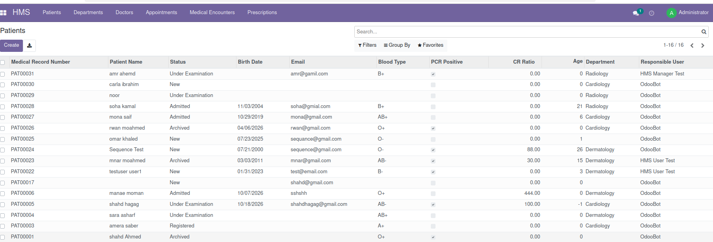

#### Patient Details
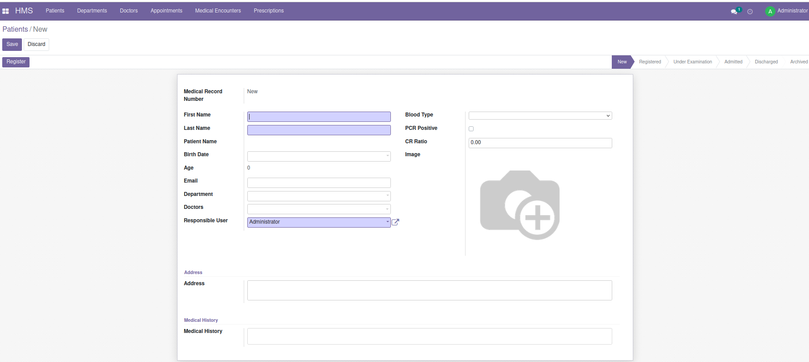

### 2. Doctor Management

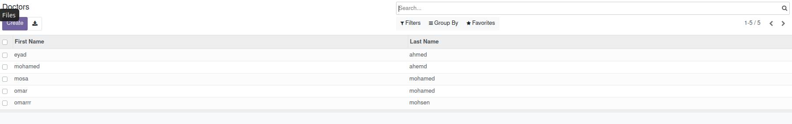

### 3. Department Management

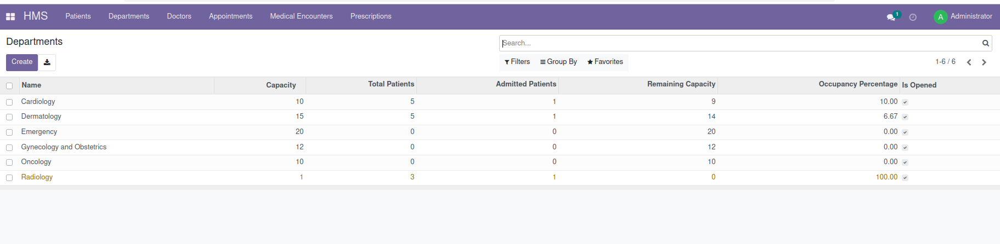

### 4. Appointment Management

#### Appointment Details
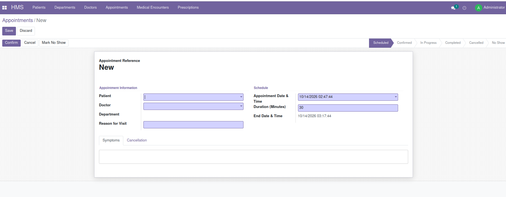

#### Appointments List
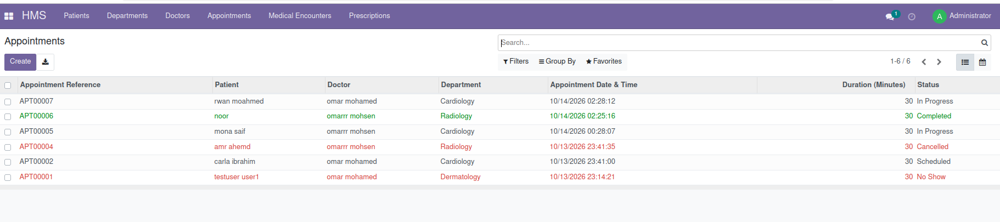

### 5. Medical Encounters

#### Medical Encounter Details
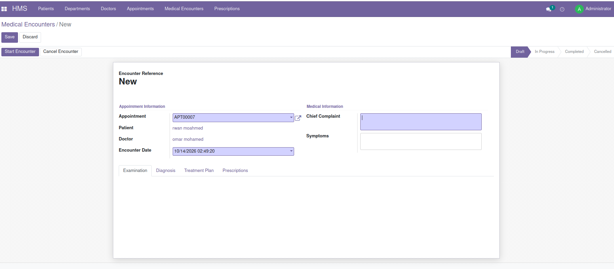

#### Medical Encounter Information
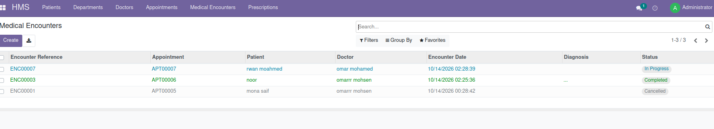

### 6. Prescription Management

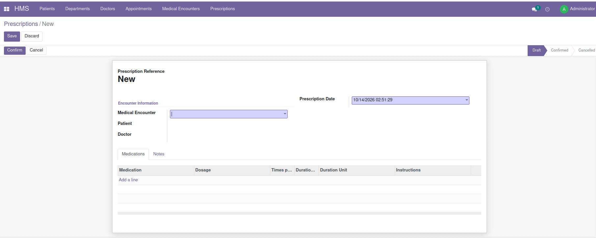

### 7. PDF Reports

#### Patient Status Report
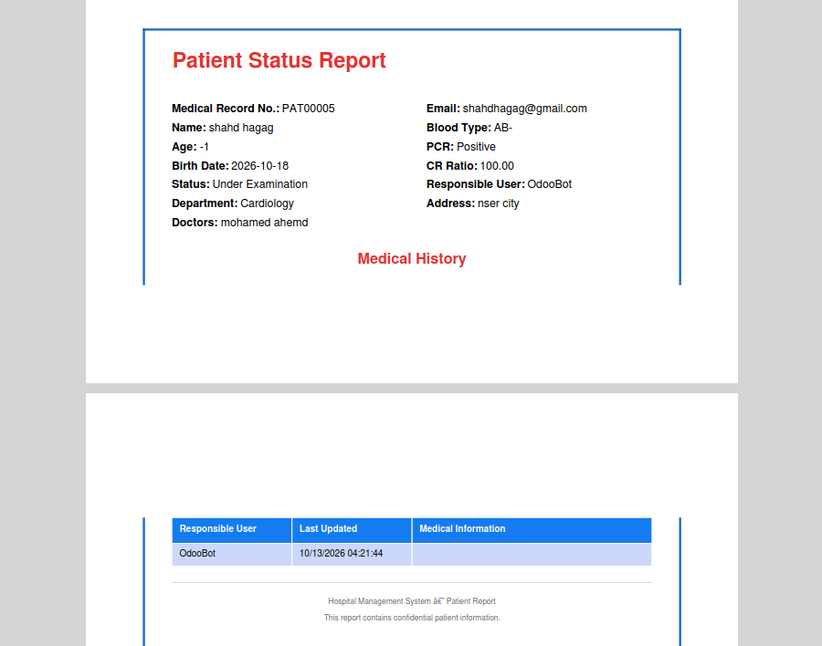

#### Prescription Report
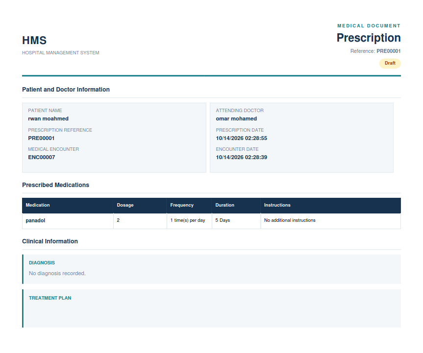
Screenshots of the application interface and PDF reports will be added here.

## 🎯 Project Goals

This project was built to practice and demonstrate:

- Odoo custom module development.
- Python model design and relationships.
- ORM fields and business logic.
- Workflow implementation.
- Data validation.
- Security groups and record rules.
- XML views and actions.
- QWeb PDF report generation.
- Git and GitHub project management.

## 📌 Future Improvements

- Improve automated testing for business workflows and access rules.
- Add more reporting and operational dashboards.
- Extend appointment scheduling and validation.
- Improve documentation with screenshots and usage examples.

## 👩‍💻 Author

**Shahd Ahmed Youssef**

- GitHub: [shahdhagag](https://github.com/shahdhagag)
- LinkedIn: [Shahd Ahmed](https://www.linkedin.com/in/shahd-ahmed-87a716296/)
